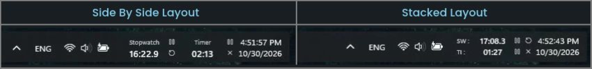
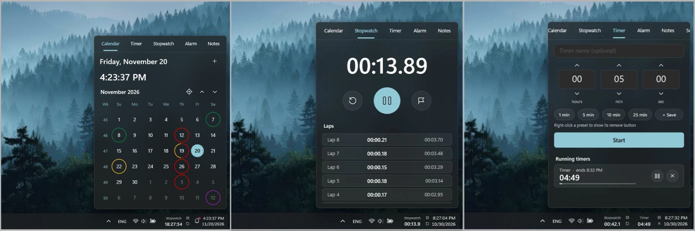
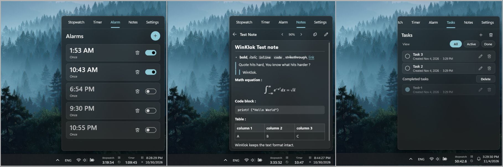
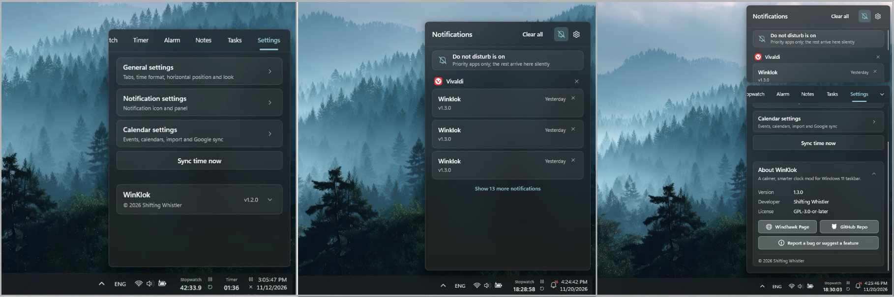

# WinKlok

**A multifunctional notification center replacement mod for Windows 11.**

WinKlok replaces the stock date/time flyout with a fast, native, Fluent-styled panel that
combines a **Calendar, Stopwatch, Timer, Alarm, Tasks, Notes** and **Settings** in one place, plus its own **notification panel**, and puts
live stopwatch and timer previews right next to the taskbar clock.

## Quick links

<table style="margin-left: auto; margin-right: auto; border-collapse: collapse; text-align: center; font-family: sans-serif;" align="center">
  <tbody>
    <tr style="border-bottom: 1px solid #ddd;">
      <td style="padding: 10px 20px; font-weight: bold;">Use WinKlok</td>
      <td style="padding: 10px 20px;"><a href="https://windhawk.net/mods/winklok" target="_blank">Open the WinKlok page on Windhawk</a></td>
    </tr>
    <tr style="border-bottom: 1px solid #ddd;">
      <td style="padding: 10px 20px; font-weight: bold;">Get Windhawk</td>
      <td style="padding: 10px 20px;"><a href="https://windhawk.net/" target="_blank">Download Windhawk</a></td>
    </tr>
    <tr style="border-bottom: 1px solid #ddd;">
      <td style="padding: 10px 20px; font-weight: bold;">Source code</td>
      <td style="padding: 10px 20px;"><a href="https://github.com/shifting-whistler/WinKlok/blob/main/WinKlok.wh.cpp" target="_blank">Read <code>WinKlok.wh.cpp</code></a></td>
    </tr>
    <tr style="border-bottom: 1px solid #ddd;">
      <td style="padding: 10px 20px; font-weight: bold;">GitHub repository</td>
      <td style="padding: 10px 20px;"><a href="https://github.com/shifting-whistler/WinKlok" target="_blank">shifting-whistler/WinKlok</a></td>
    </tr>
    <tr style="border-bottom: 1px solid #ddd;">
      <td style="padding: 10px 20px; font-weight: bold;">Issues and suggestions</td>
      <td style="padding: 10px 20px;"><a href="https://github.com/shifting-whistler/WinKlok/issues" target="_blank">Report a bug or suggest an improvement</a></td>
    </tr>
    <tr>
      <td style="padding: 10px 20px; font-weight: bold;">License</td>
      <td style="padding: 10px 20px;"><a href="https://www.gnu.org/licenses/gpl-3.0.html" target="_blank">GNU General Public License v3.0 or later</a></td>
    </tr>
  </tbody>
</table>

## A look at WinKlok

### 1. The full desktop

  

### 2. Right there on the taskbar

Ever felt tired of moving those bulky floating panels just for a stopwatch or timer ? No worries, now they are displayed directly on the taskbar.

<table align="center">

  

</table>

### 3. Inside the panel

<table>
  <tr>
    <td width="33.33%"></td>
 </tr>
 <tr>
  <td width="33.33%"></td>
 </tr>
 <tr>
  <td width="33.33%"></td>
 </tr>

</table>

## Features

### Calendar
* Month, year and decade views, with smooth vertical month scrolling like the Windows calendar.
* Today and the selected date are marked with your accent colour.
* **Events**: a thin ring of coloured segments around every date that has events, a hover card (up to five events, then "+N more"), and a double-click editor with all-day, start/end, title, description, location, colour and **Repeat** (in Local mode: none, daily, weekly, monthly or yearly, kept at the same wall-clock time across daylight saving). When you edit a repeating event, choose **This event** (only that occurrence, which can get a repetition of its own) or **All events** (the whole series; set Repeat to None to stop repeating) at the top of the editor. Each local calendar (Settings > Calendar settings) can make new events repeat yearly by default, handy for birthdays and anniversaries.
* **Local mode**: any number of local calendars (with a protected *WinKlok (default)* calendar), import of Google Takeout ZIPs, `.ics` files and iCalendar links (duplicate-safe, edits are kept), and `.ics` export.
* **Google Calendar Sync mode** (Settings > Calendar settings): two-way sync with your own Google Cloud OAuth Desktop client. Local and Google data are kept completely separate. Calendars you own can be deleted (the primary one can be emptied) from the same page; this needs the full `calendar` scope, see the Help section there.
* A **+** button on the date row adds an event for the selected day, a target button next to the month arrows jumps to today, and an optional clock with seconds can be shown at the top (Settings > General).
* Week numbers sit in a narrow column on the left and can be switched off in Calendar settings. The first day of the week and the first week of the year follow your Windows regional settings (no hard-coded ISO or Sunday rules).

### Stopwatch
* Centisecond precision, up to 200 laps (the newest lap is always on top) and a smooth lap list.
* Keeps running while the panel is closed and shows a live preview next to the clock.

### Timer
* Hours / minutes / seconds pickers, optional timer names and one-click presets you can save and remove.
* Run several timers at once. The most recently touched timer is shown beside the clock. When a timer ends, its popup offers **+1m** / **+5m** to keep going.

### Alarm
* Repeat on any days, custom label, snooze length and one of nine built-in sounds with live audition.
* The sound and snooze length you pick become the defaults for your next alarm.
* If an alarm or timer came due while the PC was off or asleep, it never rings late. One popup lists
  everything you missed, with dates and times.

### Tasks
* A minimal task list: **+** drops down the input (cursor ready, Enter adds), the trash icon deletes all tasks (two clicks to confirm).
* Slim cards with the date and time each task was created; edit or delete a task from its card.
* View: All / Active / Done. Finished tasks sink under a dimmed *Completed tasks* heading with its own Delete button.

### Notification panel
* The taskbar bell opens WinKlok's own notification panel instead of the Windows one: notifications grouped by app, relative times, dismiss one, dismiss a whole app, clear all, click to open the app.
* The icon can be left or right of the date and time, and can be always on, off, or shown only while there are notifications. It shows the number of waiting notifications. A **Do not disturb** button (a bell with a strike through it) next to the settings gear switches Windows' own Do not disturb on and off, in the same *Priority only* mode as Windows: apps on your Windows priority list can still notify you, every other app is silenced. Your priority list is never changed, and the button follows what Windows is really applying (including automatic rules and focus sessions). Notifications slide out when dismissed and the panel scrolls with the same momentum as the main panel.
* In Settings > Notification settings choose **Separate panel** (the bell opens it on its own) or **Above WinKlok**: then the clock opens the WinKlok panel with the notifications stacked above it, sliding in from the right like the native flyout. A chevron in the tab bar folds the WinKlok panel into a slim strip so the notifications extend, and back (remembered).
* Notifications are read locally from the Windows notification database (read-only copy, nothing leaves your PC). If Windows ever blocks that, the panel says so and offers the native one.

### Notes
* Any number of notes, saved automatically, with a rich preview of Markdown and LaTeX maths.
* **Paste from ChatGPT, Gemini, Google and the web and keep the structure**: headings, lists,
  tables, block quotes, code blocks, links and equations are converted to Markdown as you paste.
* Links in the preview are clickable (only the link itself), plain URLs are detected automatically.
* One-tap **Copy** button for the whole note body (the title is not included), adjustable text size, **search** (Ctrl+F) over the note list and **Export** of a note as a .md file.

### Settings
* Settings is split into **General**, **Notification** and **Calendar** pages.
* General: taskbar previews, which tabs are shown (drag them to reorder), preview layout, 12/24-hour time (applied everywhere), clock with seconds, panel material (acrylic or simple), default timer / alarm sounds and the **panel horizontal position**.
* The panel opens in the corner next to the clock (below the taskbar when the taskbar is at the top). The position slider moves it along the screen in single-pixel steps, up to the left edge (useful on ultrawide screens); the notification stack then rises from the taskbar instead of sliding in from the edge.
* **Backup and restore** of your notes, tasks, alarms, timer presets and local calendars in one file (Settings > General). Google data and sign-in details are never included.
* **Sync time now** (Windows asks for administrator permission whenever it is needed).
* A compact **About** card with the version, developer, project links and a bug / feature request button.

---

## First-run defaults
Notification icon on (left of the clock) when the Windows bell was showing (off otherwise), taskbar previews on, time format following Windows, acrylic blur, side-by-side layout, the *Windows Alarm*
tone for both timers and alarms.

## Getting started
1. Install and enable the mod in Windhawk.
2. WinKlok takes over the taskbar clock within a second or so. If the clock does not change, restart
   Windows Explorer from Task Manager.
3. Have fun...

## Tips
* Scroll over the tab bar to reveal more tabs, or click a tab to slide it to the centre.
* Right-click a timer preset to reveal its remove button.
* WinKlok always hides the Windows notification bell while it runs. Its own notification icon is optional: turn it off in Settings and, with *Above WinKlok*, the clock still opens the notifications together with the panel.

## Compatibility
* Windows 11 with the XAML taskbar, 64-bit only.
* Do not combine with other mods that rebuild the taskbar clock area (for example *Taskbar Clock
  Customization*) until you have verified they coexist.
* The panel always rests next to the taskbar (above a bottom taskbar, below a top one), even when it is set to auto-hide (it keeps clear of the area the taskbar occupies when shown).
* WinKlok does not change the taskbar height. Use the *Taskbar height and icon size* mod for that.
* To turn WinKlok off, disable the mod in Windhawk: the taskbar clock goes back to Windows immediately.
* If something misbehaves, enable logging for this mod in Windhawk and check the log.

## For developers
* Single-file C++ mod, organised in blocks: engine and persistence, taskbar integration (XAML
  injection and hooks), native UI primitives, sound synthesis, rich-text and LaTeX engine, panel
  pages and alert windows.
* Rendering is plain Win32 + Direct2D/DirectWrite. There is no browser engine and no external asset.
* Alarm sounds are synthesised at runtime into in-memory WAV buffers, so nothing needs to be shipped.
* The pasted-HTML to Markdown converter lives next to the Notes editor and understands the clipboard
  *HTML Format* produced by modern browsers and chat apps.
* Contributions, bug reports and ideas are welcome on GitHub.

## Contributing and support

Bug reports, compatibility notes, ideas, and pull requests are welcome in the [GitHub Issues](https://github.com/shifting-whistler/WinKlok/issues) and [repository](https://github.com/shifting-whistler/WinKlok).

Made by **Shifting Whistler**.

---

WinKlok is free and open-source software licensed under **GPL-3.0-or-later**. See the [full licence text](https://www.gnu.org/licenses/gpl-3.0.html) for the terms.

