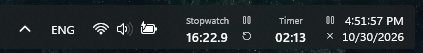
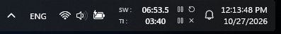
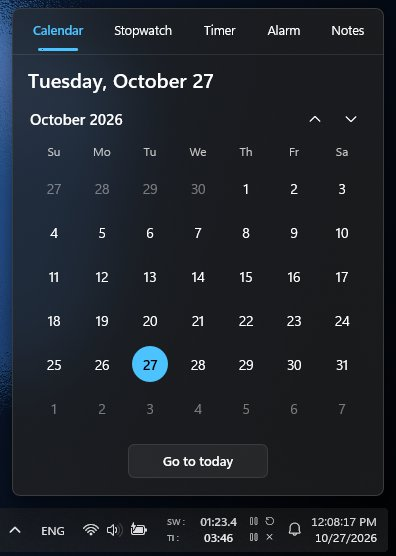
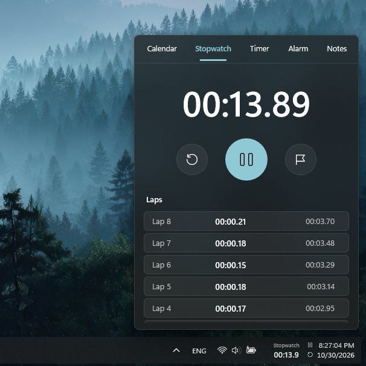
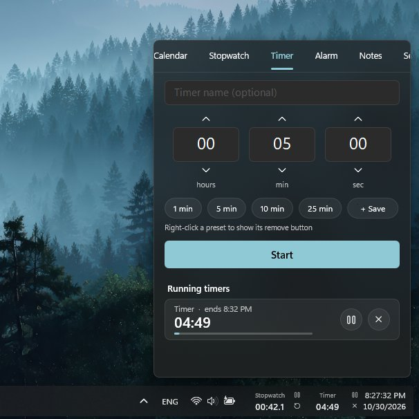
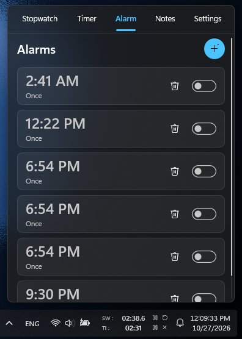
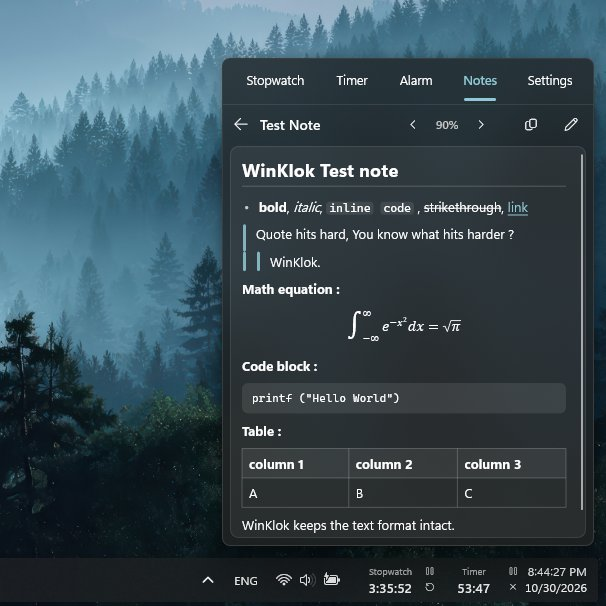
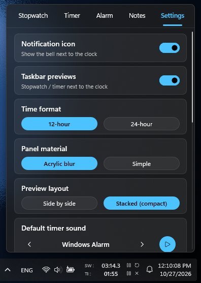

# WinKlok

**A calmer, smarter clock mod for Windows 11 taskbar.**

WinKlok gives the Windows 11 taskbar clock a little more to do. Click the date/time area to open a native, Fluent-inspired panel for your calendar, stopwatch, timers, alarms, notes, and settings—with live stopwatch and timer previews beside the clock.

Windows' built-in clock is perfectly good at telling you the time. The rest of the job, apparently, was left as an exercise for the user.

## Quick links

<table style="margin-left: auto; margin-right: auto; border-collapse: collapse; text-align: center; font-family: sans-serif;" align="center">
  <tbody>
    <tr style="border-bottom: 1px solid #ddd;">
      <td style="padding: 10px 20px; font-weight: bold;">Use WinKlok</td>
      <td style="padding: 10px 20px;"><a href="https://windhawk.net/mods/winklok" target="_blank">Open the WinKlok page on Windhawk</a></td>
    </tr>
    <tr style="border-bottom: 1px solid #ddd;">
      <td style="padding: 10px 20px; font-weight: bold;">Get Windhawk</td>
      <td style="padding: 10px 20px;"><a href="https://windhawk.net/" target="_blank">Download Windhawk</a></td>
    </tr>
    <tr style="border-bottom: 1px solid #ddd;">
      <td style="padding: 10px 20px; font-weight: bold;">Source code</td>
      <td style="padding: 10px 20px;"><a href="https://github.com/shifting-whistler/WinKlok/blob/main/WinKlok.wh.cpp" target="_blank">Read <code>WinKlok.wh.cpp</code></a></td>
    </tr>
    <tr style="border-bottom: 1px solid #ddd;">
      <td style="padding: 10px 20px; font-weight: bold;">GitHub repository</td>
      <td style="padding: 10px 20px;"><a href="https://github.com/shifting-whistler/WinKlok" target="_blank">shifting-whistler/WinKlok</a></td>
    </tr>
    <tr style="border-bottom: 1px solid #ddd;">
      <td style="padding: 10px 20px; font-weight: bold;">Issues and suggestions</td>
      <td style="padding: 10px 20px;"><a href="https://github.com/shifting-whistler/WinKlok/issues" target="_blank">Report a bug or suggest an improvement</a></td>
    </tr>
    <tr>
      <td style="padding: 10px 20px; font-weight: bold;">License</td>
      <td style="padding: 10px 20px;"><a href="https://www.gnu.org/licenses/gpl-3.0.html" target="_blank">GNU General Public License v3.0 or later</a></td>
    </tr>
  </tbody>
</table>

## A look at WinKlok

### 1. The full desktop

  

### 2. Right there on the taskbar

Ever felt tired of moving those bulky floating panels just for a stopwatch or timer ? No worries, now they are displayed directly on the taskbar.

<table align="center">
  <tr align="center">     
    <th>Side by Side Layout</th>     
    <th>Stacked (compact) Layout</th>  
  </tr>
  <tr>
    <td width="50%"></td>
    <td width="50%"></td>
  </tr>
</table>

### 3. Inside the panel

<table>
  <tr>
    <td width="33.33%"></td>
    <td width="33.33%"></td>
    <td width="33.33%"></td>
  </tr>
  <tr>
  <td width="33.33%"></td>
  <td width="33.33%"></td>
  <td width="33.33%"></td>
</tr>

</table>

## What it does

### Calendar

- Month, year, and decade views, with smooth vertical month scrolling.
- Today and the selected date use your Windows accent colour.
- The first day of the week follows your Windows regional setting.

### Stopwatch

- Centisecond display precision and a lap list with the newest lap at the top.
- Keeps running while the panel is closed.
- Shows a live preview beside the taskbar clock while in use.

### Timers

- Hours, minutes, and seconds controls, optional names, and reusable presets.
- Run multiple timers at once.
- The most recently started or interacted-with timer gets the taskbar preview.

### Alarms

- Repeat on selected weekdays, add a label, choose a snooze duration, and pick from nine built-in sounds.
- Preview sounds before choosing them.
- If a timer or alarm becomes overdue while the PC is off or asleep, WinKlok reports it instead of surprising you with a late ring after you return.

### Notes

- Create as many notes as you need; changes save automatically.
- Preview Markdown and LaTeX maths.
- Paste rich content from browsers and common chat/AI tools while preserving supported structure such as headings, lists, tables, block quotes, code blocks, links, and equations.
- Clickable links in previews, automatic plain-URL detection, adjustable text size, and a one-tap copy action for the note body.

### Taskbar integration and settings

- Native Win32, Direct2D, and DirectWrite rendering—no embedded browser UI.
- Acrylic or simple panel material, light/dark theme support, and Windows-style slide-up animation.
- Mouse-wheel, touch, pen, and precision touchpad scrolling.
- Optional taskbar previews and notification icon, configurable 12/24-hour display, preview layout, taskbar height, and default timer/alarm sounds.
- Controls to sync system time, reload Explorer/the taskbar, or quit WinKlok and return the clock area to Windows.

## Getting started

1. Install [Windhawk](https://windhawk.net/).
2. Open the [WinKlok mod page](https://windhawk.net/mods/winklok) and install/enable the mod through Windhawk. 
3. Restart the Windows Explorer from the task manager.
4. Have fun...

On an already-running taskbar, the first clock refresh can take up to a minute or it might not even appear. Restart the Windows Explorer to fix this issue.

## Compatibility and notes

- Windows 11 with the XAML-based taskbar; 64-bit only.
- Other taskbar mods that replace or rebuild the clock area may conflict. If you use one, test compatibility rather than assuming two mods can safely occupy the same pixels.
- The optional notification bell is off by default.
- WinKlok does not download videos, make accounts, or send telemetry. Its data is stored locally through Windhawk's storage facilities.
- If something goes wrong, enable **Verbose logging** in the mod settings and review the Windhawk log.

### About system-time sync

Windows restricts system-clock changes to administrators. The first **Sync time now** operation asks for permission and creates a small, on-demand **WinKlok Time Sync** scheduled task. Later syncs can run without another prompt. The task can be removed from Windows Task Scheduler.

## For developers

WinKlok is distributed as a single Windhawk C++ mod source file: [`WinKlok.wh.cpp`](WinKlok.wh.cpp).

- **Rendering:** Win32 + Direct2D + DirectWrite.
- **Taskbar integration:** Windows UI/XAML inspection, event hooks, and preview injection.
- **Timekeeping:** stopwatch, timers, alarms, persistence, missed-event reporting, and scheduling logic.
- **Notes:** a rich-text preview engine and clipboard HTML-to-Markdown conversion.
- **Sounds:** alarm sounds are synthesised at runtime into in-memory WAV data; no sound assets need to be shipped.

### Working on the source

1. Install Windhawk and use its mod editor/build environment, or follow the current [Windhawk documentation](https://windhawk.net/).
2. Make changes in `WinKlok.wh.cpp`, keeping the `WindhawkMod`, `WindhawkModReadme`, and `WindhawkModSettings` metadata blocks intact.
3. Test on a Windows 11 x64 machine. Pay particular attention to Explorer/taskbar lifecycle, multiple monitors, light and dark themes, display scaling, touchpad scrolling, and taskbar preview sizing.
4. Test timer/alarm behavior across sleep/restart scenarios before publishing a release.

The taskbar is a moving target, so small Windows updates can change internal XAML details. Re-test after major Windows updates, and include the Windows build and relevant Windhawk log excerpt in bug reports.

## Contributing and support

Bug reports, compatibility notes, ideas, and pull requests are welcome in the [GitHub Issues](https://github.com/shifting-whistler/WinKlok/issues) and [repository](https://github.com/shifting-whistler/WinKlok).

Made by **Shifting Whistler**.

---

WinKlok is free and open-source software licensed under **GPL-3.0-or-later**. See the [full licence text](https://www.gnu.org/licenses/gpl-3.0.html) for the terms.

